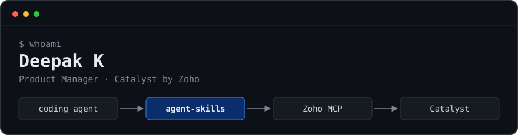

<p align="center">
  
</p>

I work where coding agents meet cloud platforms. My focus is giving agents enough platform knowledge to write code that actually deploys, then verifying what they produce.

---

### [catalystbyzoho/agent-skills](https://github.com/catalystbyzoho/agent-skills)

[](https://github.com/catalystbyzoho/agent-skills/stargazers)
[](https://github.com/catalystbyzoho/agent-skills/blob/main/LICENSE)
[](https://github.com/catalystbyzoho/agent-skills/tree/main/skills)
[](https://github.com/catalystbyzoho/agent-skills)

Agent Skills that teach coding agents to build on Catalyst. I built it and maintain it.

| Layer | Coverage |
|---|---|
| Compute | Functions (7 types, API Gateway, security rules) · AppSail (PaaS, Docker) · Job Scheduling |
| Hosting | Slate (frontend, Git deploy, SSR) |
| Data | Data Store + ZCQL · NoSQL · Stratus object storage · Cache |
| Events | Signals (event bus, rules, webhooks) |
| AI / ML | QuickML (LLM serving, RAG, AutoML) · Zia |
| Platform | Auth + OAuth Connections · SDKs for 7 runtimes · CLI & environments · Pricing |
| Infra via MCP | Provisioning through Zoho MCP (`CatalystbyZoho_*` tools) |

- **Verified, not generated:** a runnable eval suite in claude-plugin-eval format, plus an audit pass that removed fabricated APIs and cross-skill contradictions
- **Lean by design:** tiered references that fall back to live docs instead of bundling a docs dump

**Works with**


```bash
npx skills add catalystbyzoho/agent-skills
```

---

### Builds

| Project | Notes | |
|---|---|---|
| [my-home-3D](https://github.com/deepakthamizhK/my-home-3D) | 3D house-plan prototype built with Claude | [live ↗](https://myhome3d.vercel.app) |

### Now

Eval-driven hardening of the skills: verifying SDK and REST contracts against live services, and region/data-center coverage.

---

<p>
  <a href="https://x.com/deepakThamizhK"></a>
  &nbsp;notes on agents, serverless and deployment
</p>
